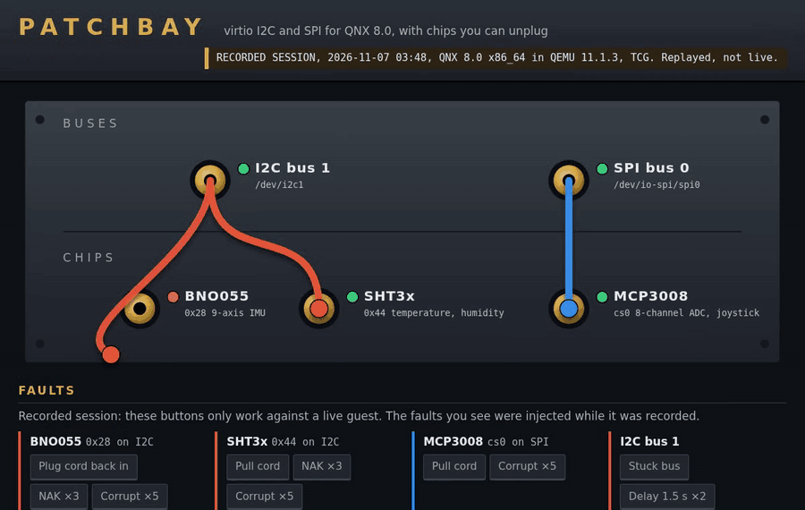
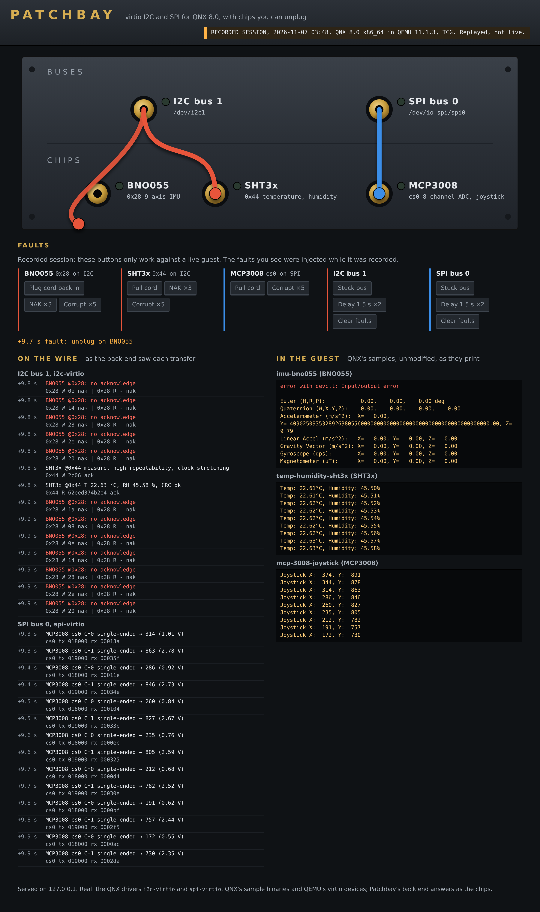
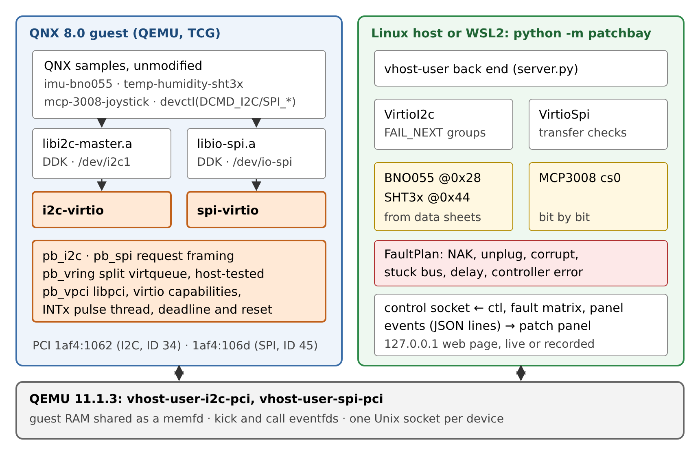

# Patchbay

[](https://github.com/Marc-Dvci/Patchbay/actions/workflows/tests.yml)
[](#evidence)
[](docs/results/fault_matrix.md)
[](LICENSE)
[](#build-and-run)

**Virtio I2C and SPI master drivers for QNX 8.0, built on the QNX Driver Development Kit, with a back end that
simulates real sensor chips, so QNX's own sensor samples run unmodified in a VM, with no board.**

[](docs/panel-1440.png)

> [!TIP]
> No QNX licence, no guest: `python3 -m patchbay panel --recorded` and open http://127.0.0.1:8093/. It replays a
> session recorded from a real guest, and says so on the page. Or `docker compose up demo` (no keys, serves the same
> page on 127.0.0.1:8093), or open this repository in a Codespace: the dev container starts the same page.

| | |
|---|---|
| Track | Low-level Software (device drivers with the QNX DDK) |
| Built with | QNX SDP 8.0 (`qcc`, `libi2c-master.a`, `libio-spi.a`, `libpci`), QEMU 11.1.3 vhost-user, Python 3.12 |
| Target | QNX 8.0 x86_64 guest in QEMU (also builds for aarch64le) |
| Headline | 3 unmodified QNX samples run on simulated BNO055, SHT3x and MCP3008; 16 of 16 fault rows as expected ([results](docs/RESULTS.md)) |

[For judges](#for-judges) · [The patch panel](#the-patch-panel) · [Run it](#build-and-run) ·
[How it works](#how-it-works) · [Evidence](#evidence)

## For judges

| Criterion | Where to look |
|---|---|
| Technological implementation | DDK drivers: [`i2c_master_getfuncs()`](https://github.com/Marc-Dvci/Patchbay/blob/v1.0.0/driver/qnx/i2c-virtio.c#L286-L301) and [`i2cv_xfer()`](https://github.com/Marc-Dvci/Patchbay/blob/v1.0.0/driver/qnx/i2c-virtio.c#L199-L221) in `i2c-virtio.c`; [`spi_init()`](https://github.com/Marc-Dvci/Patchbay/blob/v1.0.0/driver/qnx/spi-virtio.c#L164-L229) and [`spiv_xfer()`](https://github.com/Marc-Dvci/Patchbay/blob/v1.0.0/driver/qnx/spi-virtio.c#L107-L149) in `spi-virtio.c`; the virtio PCI transport, [`find_caps()`](https://github.com/Marc-Dvci/Patchbay/blob/v1.0.0/driver/qnx/pb_vpci.c#L152-L217), [`bring_up()`](https://github.com/Marc-Dvci/Patchbay/blob/v1.0.0/driver/qnx/pb_vpci.c#L231-L294) and the interrupt thread [`irq_loop()`](https://github.com/Marc-Dvci/Patchbay/blob/v1.0.0/driver/qnx/pb_vpci.c#L309-L331); split ring [`pb_vring.c`](driver/core/pb_vring.c); vhost-user back end [`patchbay/server.py`](patchbay/server.py); a lost interrupt traced to its cause ([RESULTS](docs/RESULTS.md#a-lost-interrupt-found-by-the-fault-matrix-root-cause-and-fix)) |
| Design | the [patch panel](#the-patch-panel): pull a cord, watch QNX's sample react; one script from nothing to a running sample: [`scripts/demo.sh`](scripts/demo.sh) |
| Potential impact | [The problem](#the-problem) |
| Innovation | real chip models from data sheets ([`patchbay/chips/`](patchbay/chips)); a fault matrix against QNX's own sample API ([`scripts/fault_matrix.py`](scripts/fault_matrix.py)); the driver's C core tested against an independent Python device ([`tests/cross/`](tests/cross)) |
| Evidence | [`docs/RESULTS.md`](docs/RESULTS.md), raw outputs in [`docs/results/`](docs/results) |

## The problem

QNX's sensor samples ([qnx/Raspberry-Pi-Hardware-Component-Samples](https://github.com/qnx/Raspberry-Pi-Hardware-Component-Samples))
open `/dev/i2c1` and `/dev/io-spi/spi0/dev0` on a Raspberry Pi. A student without a Pi, or without the sensor
breakout, cannot run them. QNX's academic programme has engaged more than 24,000 students in workshops and coursework
([QNX, 2 Nov 2026](https://www.newswire.com/news/qnx-launches-global-developer-hackathon-with-50-000-in-prizes-to-accelerate)),
and a sample that needs a board and a breakout is out of reach for any of them who have neither.

The same gap exists in production. On a hypervisor, a guest reaches its peripherals through virtio: the guest runs a
virtio driver and the device lives in another VM or process. The virtio specification defines an I2C adapter (device
34) and an SPI controller (device 45). For QNX's own guest driver package, `com.qnx.qnx800.target.driver.virtio`, the
software center's package metadata lists block and console drivers only (see [RESULTS](docs/RESULTS.md#kill-tests)).
No public QNX port of a virtio I2C or SPI driver was found.

Patchbay fills both: the drivers are ordinary DDK drivers a QNX guest can use on any hypervisor that offers these
devices, and the back end gives a student the chips.

## The patch panel

A driver has no screen, so Patchbay draws the bench: the two buses on top, the chips below, a cord for each
connection. `scripts/run_guest.sh panel` opens it next to a running guest, with QNX's three samples running in it:

- every transfer on each bus as the back end saw it, with the chip's reading of it: `BNO055 @0x28 CHIP_ID = 0xA0`,
  `SHT3x @0x44 T 22.63 °C, RH 45.58 %, CRC ok`, `MCP3008 cs0 CH0 single-ended → 212 (0.68 V)`;
- buttons to pull a cord, make a chip refuse transfers, corrupt its readings, hold a bus stuck or delay it. Each sends
  the same control request as the fault matrix;
- the samples' own output beside it, as they print it in the guest.



`python3 -m patchbay panel --recorded` replays a 50-second session recorded from a real guest
([which run](docs/RESULTS.md#the-patch-panels-recorded-session)); the banner says it is a recording, and the fault
buttons come alive against a live guest. The page is served on 127.0.0.1, puts every value from the guest on the
page as text, works from the keyboard, and has no axe-core WCAG 2.2 AA violations at 1440 and 390 px (`tests/e2e/`).

## How it works



<details><summary>The same as text</summary>

```
 QNX 8.0 guest (QEMU)                                   Linux host (or WSL2)
 imu-bno055  temp-humidity-sht3x  mcp-3008-joystick     python -m patchbay serve
   (upstream, unmodified)                                 vhost-user socket per device
   devctl(DCMD_I2C_*)   devctl(DCMD_SPI_*)                VirtioI2c ── I2cBus: BNO055 @0x28, SHT3x @0x44
 /dev/i2c1            /dev/io-spi/spi0/dev0               VirtioSpi ── SpiBus: MCP3008 on cs0
 libi2c-master.a      libio-spi.a       (QNX DDK)         FaultPlan <── control socket (JSON)
 i2c-virtio           spi-virtio        (Patchbay)
   pb_i2c / pb_spi framing, pb_vring split ring  (portable C, tested on the host)
   pb_vpci: libpci, virtio capabilities, INTx, deadlines
        │ PCI 1af4:1062, 1af4:106d
 QEMU vhost-user-i2c-pci, vhost-user-spi-pci ─────────── shared guest RAM (memfd), kick/call eventfds
```

</details>

QEMU keeps the PCI device model; the request queues are served by the back end, which reads and writes the guest's
memory directly. Each transfer has a deadline (1000 ms by default): a device that stops answering is reset, the
transfer fails with EIO (I2C) or ETIMEDOUT (SPI), and the next transfer starts on an empty queue.

## How QNX is used

| QNX part | Use |
|---|---|
| I2C DDK, `libi2c-master.a` | provides `main()`, the resource manager at `/dev/i2c<unit>` and the `DCMD_I2C_*` devctls; Patchbay supplies the hardware functions through `i2c_master_getfuncs()` |
| SPI DDK, `libio-spi.a` | parses `spi.conf`, runs a bus thread and a node per device; Patchbay supplies `spi_init()` and `spi_funcs_t` |
| PCI server, `libpci` | `pci_device_find`, `pci_device_attach`, capability walk in configuration space, `pci_device_map_as`, `pci_device_read_irq`, checked against the Interrupt Line register |
| Kernel | `InterruptAttachEvent()` with a pulse, `InterruptUnmask()` on a dedicated thread (the INTx line is shared), `ThreadCtl(_NTO_TCTL_IO_LEVEL)`, `mmap(MAP_PHYS)` and `mem_offset64()` for DMA memory |
| `mkqnximage` | builds the guest image with the drivers, `spi.conf`, the samples and `pbprobe` ([`image/`](image)) |

### Evidence of QNX use

- `driver/qnx/i2c-virtio.c`: `i2c_master_getfuncs()`, `i2cv_send()`, `i2cv_recv()`, `i2cv_xfer()`
- `driver/qnx/spi-virtio.c`: `spi_init()`, `spiv_xfer()`, `spiv_setcfg()`, `spi_create_devs()` call
- `driver/qnx/pb_vpci.c`: `pb_vpci_open()`, `find_caps()`, `bring_up()`, `pb_vpci_run()`, `start_irq()`, `irq_loop()`
- `driver/Makefile`: links `-l:libi2c-master.a` and `-l:libio-spi.a` with `qcc -Vgcc_ntox86_64`
- Output from the guest: [`docs/results/guest_devices.txt`](docs/results/guest_devices.txt),
  [`docs/results/sample_imu-bno055.txt`](docs/results/sample_imu-bno055.txt),
  [`docs/results/fault_matrix.md`](docs/results/fault_matrix.md)

## Scope

The drivers speak virtio I2C with 7-bit addresses and virtio SPI with 8-bit words (16 and 32 where the controller
offers them), and hand every device status to the client as the DDK's error codes: EIO for a NAK or a stuck I2C bus,
ETIMEDOUT for a stuck SPI bus. The chip models follow their data sheets for everything QNX's samples use; each model's
source file lists what it covers. Every figure is an outcome (completed, failed, timed out, recovered, counts),
measured in QEMU with TCG.

> [!IMPORTANT]
> Real: the QNX drivers, the QNX sample binaries, and the virtio devices in QEMU, all running in a QNX 8.0 guest.

## Evidence

All figures and their commands are in [`docs/RESULTS.md`](docs/RESULTS.md). In short (QEMU, TCG):

| Claim | Command | Test or file |
|---|---|---|
| The three samples run unmodified | `scripts/evidence.sh` | `docs/results/sample_*.txt` |
| 16 of 16 fault rows behave as expected; after each of the 15 fault rows the driver is still running and the next transfer succeeds | `python3 scripts/fault_matrix.py` | `docs/results/fault_matrix.md` |
| The C ring and framing agree with an independent Python device | `scripts/host_tests.sh` | `tests/cross/` |
| A recorded panel session from a real guest replays with no QNX | `python3 -m patchbay panel --recorded` | `tests/unit/test_panel.py` |
| The panel has no WCAG 2.2 AA violations (axe-core) and works from the keyboard | `pytest tests/e2e` | `tests/e2e/test_panel_browser.py` |
| Each of 9 deliberate bugs in the C core is caught | `scripts/mutation_check.sh` | `scripts/mutation_check.sh` |
| Chip models match their data sheets' examples (CRC-8 0xBEEF → 0x92, BNO055 IDs, MCP3008 bit order) | `scripts/host_tests.sh` | `tests/unit/test_sht3x.py`, `test_bno055.py`, `test_mcp3008.py` |

Tests: 17 C unit tests (106 checks, under ASan and UBSan) · 150 Python unit · 13 cross · 19 integration ·
5 browser. Back end coverage, lines and branches: 89 %.

## Build and run

**QNX version:** QNX SDP 8.0 (free QNX Everywhere licence). **Target:** QNX 8.0 x86_64 guest in QEMU 11.1.3.
**Toolchain:** `qcc -Vgcc_ntox86_64` (GCC 12.2) from the SDP. **Host:** Linux x86_64 or WSL2 (Ubuntu 22.04 tested),
Python 3.12. vhost-user runs on QEMU for Linux, so the guest runs in Linux or WSL2.

> [!TIP]
> One command, from a machine with QNX SDP 8.0 in `~/qnx800`:
> `scripts/demo.sh` builds QEMU 11.1.3 the first time, then the drivers, the samples and the image, boots the guest
> and prints the three samples' output.

Step by step:

```bash
sudo apt install build-essential ninja-build pkg-config libglib2.0-dev libpixman-1-dev libslirp-dev \
     python3-venv flex bison curl xz-utils
scripts/build_qemu.sh            # QEMU 11.1.3 with vhost-user-spi-pci, into ~/Patchbay-work/qemu
scripts/build_drivers.sh         # i2c-virtio, spi-virtio, pbprobe; the upstream samples at a pinned commit
image/build.sh                   # QNX image with mkqnximage
scripts/run_guest.sh start       # back end + guest; ssh on 127.0.0.1:2252
scripts/run_guest.sh ssh imu-bno055
scripts/run_guest.sh panel       # the patch panel, live, on http://127.0.0.1:8093/
scripts/run_guest.sh ctl fault nak --bus i2c --target 0x28 --count 3     # or from the command line
scripts/run_guest.sh stop
```

Host tests only (no QNX SDP needed):

```bash
python3.12 -m venv .venv && . .venv/bin/activate && pip install -r requirements-dev.txt
scripts/host_tests.sh
```

## Layout

| Path | What |
|---|---|
| `driver/core/` | portable C: split virtqueue, virtio-i2c and virtio-spi framing |
| `driver/qnx/` | the two DDK drivers and the virtio PCI transport |
| `driver/tools/pbprobe.c` | one-line-per-transfer probe used by the fault matrix |
| `driver/tests/` | C unit tests of the core |
| `patchbay/` | the back end: vhost-user, virtio devices, buses, faults, chip models, decoder |
| `patchbay/panel.py`, `patchbay/panel_static/` | the patch panel's server and page |
| `patchbay/recordings/` | the recorded session the panel replays |
| `image/` | mkqnximage snippets, `spi.conf`, start script |
| `scripts/` | build, boot, demo, evidence, fault matrix, mutation check |
| `tests/` | Python unit, cross, integration and browser tests |

`scripts/host_tests.sh` runs everything that needs no QNX SDP.

## Built on

- QNX SDP 8.0 DDK libraries and headers (QNX Everywhere licence), not redistributed here.
- QEMU 11.1.3's `vhost-user-i2c-pci` and `vhost-user-spi-pci` (GPL-2.0-or-later), built from the official tarball, not included.
- QNX's sample programs, [qnx/Raspberry-Pi-Hardware-Component-Samples](https://github.com/qnx/Raspberry-Pi-Hardware-Component-Samples) (Apache-2.0), fetched and built at commit `fb1f9df`, not copied.
- Structure layouts from the virtio specification and Linux's `include/uapi/linux/virtio_i2c.h` and `virtio_spi.h`, restated, not copied.

## Licence

MIT, see [LICENSE](LICENSE).
